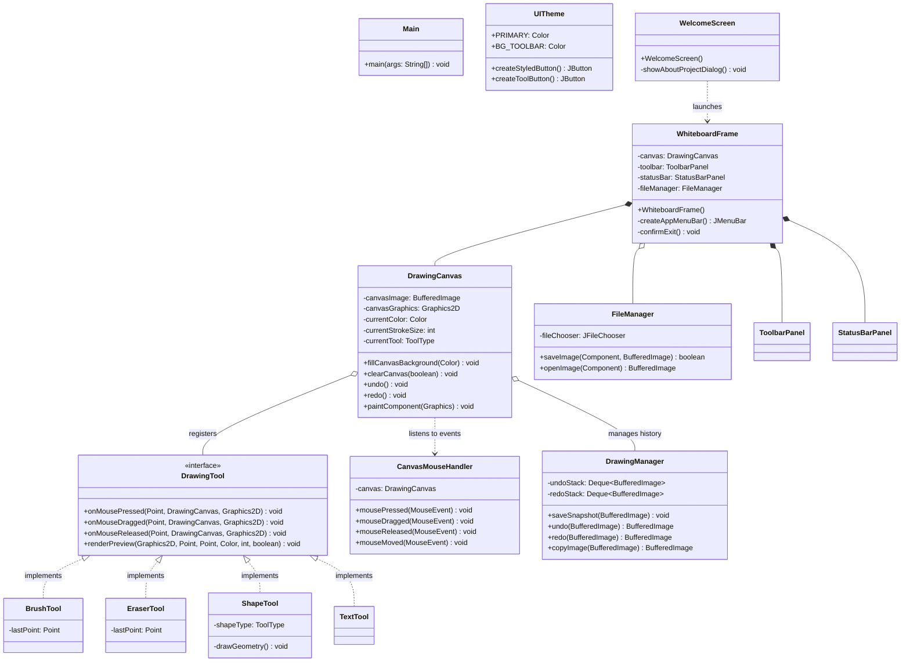

# 🎨 Digital Whiteboard – Interactive Drawing Application

> **Academic Course:** Object-Oriented Programming with Java  
> **Level:** Semester 3 Computer Science & Engineering Project  
> **Technologies:** Core Java, Java Swing (GUI), Java 2D Graphics (AWT), Event-Driven Architecture, HTML5/CSS3 Showcase

---

## 1. Project Overview & Synopsis

**Digital Whiteboard** is a desktop drawing, sketching, and diagramming application developed in Java. It provides an intuitive digital canvas that replicates a real-world whiteboard while enhancing it with computer-aided precision tools:
- Freehand drawing with smooth anti-aliased interpolation.
- Geometric shapes (lines, rectangles, circles/ovals) with interactive live rubberband preview.
- Dynamic color selection with standard palette swatches and deep RGB selection via `JColorChooser`.
- Bounded multi-level **Undo & Redo** state history using double-buffered memory snapshots.
- Artwork persistence through file export to **PNG** and **JPEG** formats using `ImageIO`.
- A supplementary **HTML5/CSS3 Web Showcase** for academic presentations.

---

## 2. Problem Statement & Objectives

### Problem Statement
Traditional physical whiteboards and basic educational graphics demos often suffer from key limitations:
1. **Transient Canvas:** Artwork cannot be saved, restored, or exported digitally.
2. **Flickering & Loss on Repaint:** Naive GUI implementations redraw blindly on `paint()`, causing drawings to vanish when windows are minimized, resized, or overlapped.
3. **Lack of Reversibility:** Without an Undo/Redo architecture, mistakes require wiping the entire board.

### Project Objectives
- Build a robust desktop drawing application using standard Java Swing and AWT.
- Implement an off-screen `BufferedImage` buffer so artwork persists across minimize, maximize, and resize events.
- Demonstrate core Object-Oriented Design Principles (Polymorphism, Abstraction, Encapsulation, and Inheritance).
- Utilize event listeners (`MouseListener`, `MouseMotionListener`, `ActionListener`) to achieve smooth user interactivity.
- Provide a modern dark-themed user interface that stands out as a polished, portfolio-grade project.

---

## 3. Project Architecture

The application adopts a decoupled Model-View-Controller (MVC) and Strategy pattern structure:

```
┌─────────────────────────────────────────────────────────────┐
│                       WhiteboardFrame                       │
│  ┌───────────────────────┐       ┌───────────────────────┐  │
│  │     ToolbarPanel      │       │     StatusBarPanel    │  │
│  └───────────┬───────────┘       └───────────▲───────────┘  │
│              │ (tool/color changes)          │ (coords/dim) │
│              ▼                               │              │
│  ┌───────────────────────────────────────────┴───────────┐  │
│  │                     DrawingCanvas                     │  │
│  │   - BufferedImage (Persistent Backing Store)          │  │
│  │   - Graphics2D (Anti-Aliasing & Rendering Hints)      │  │
│  └───────────┬───────────────────────────────▲───────────┘  │
└──────────────┼───────────────────────────────┼──────────────┘
               ▼                               │
  ┌─────────────────────────┐     ┌────────────┴────────────┐
  │   CanvasMouseHandler    │     │      DrawingManager     │
  │   - mousePressed()      │     │   - undoStack (Deque)   │
  │   - mouseDragged()      │     │   - redoStack (Deque)   │
  │   - mouseReleased()     │     │   - deepCopy snapshots  │
  └────────────┬────────────┘     └─────────────────────────┘
               ▼
  ┌─────────────────────────────────────────────────────────┐
  │              DrawingTool (Strategy Interface)           │
  │  ├── BrushTool (Pencil / Freehand)                      │
  │  ├── EraserTool (Background color painting)             │
  │  ├── ShapeTool (Line, Rect, Oval, Filled Shapes)        │
  │  └── TextTool (Interactive Font Placement)              │
  └─────────────────────────────────────────────────────────┘
```

---

## 4. Mermaid Flowchart & UML Diagrams

### A. Application Workflow Flowchart
```mermaid
flowchart TD
    Start([Launch Main.java]) --> Splash[Show WelcomeScreen]
    Splash -->|Click 'Start Drawing'| InitFrame[Initialize WhiteboardFrame]
    Splash -->|Click 'About Project'| ShowAbout[Show Project Synopsis Modal]
    Splash -->|Click 'Exit'| Terminate([Exit Application])

    InitFrame --> CanvasInit[DrawingCanvas Allocates BufferedImage Buffer]
    CanvasInit --> EventLoop[Wait for User Mouse & Action Events]

    EventLoop -->|Mouse Pressed| SaveSnap[DrawingManager saves Undo Snapshot]
    SaveSnap --> ToolPress[Active Tool onMousePressed]

    EventLoop -->|Mouse Dragged| DragCheck{Is Shape Tool?}
    DragCheck -->|Yes| Rubberband[Render Live Preview on Screen]
    DragCheck -->|No (Brush/Eraser)| LiveDraw[Draw onto BufferedImage Buffer]

    EventLoop -->|Mouse Released| CommitShape[Commit Shape permanently to Buffer]
    CommitShape --> Repaint[Repaint Canvas Viewport]

    EventLoop -->|Ctrl+Z / Undo| UndoAction[Pop previous snapshot from UndoStack]
    UndoAction --> Repaint

    EventLoop -->|Ctrl+S / Save| SaveAction[FileManager opens JFileChooser & writes PNG/JPG]
```

### B. UML Class Diagram


---

## 5. Core Java Concepts Demonstrated

| Java Concept | How and Where it is Applied in this Project |
| :--- | :--- |
| **Classes & Objects** | Every component (`DrawingCanvas`, `ToolbarPanel`, `FileManager`) is encapsulated as an independent class instantiated as a working object. |
| **Encapsulation** | Drawing states (`currentColor`, `currentStrokeSize`, `canvasImage`) are kept `private`, accessible only via public getters and setters with validation logic. |
| **Inheritance** | `DrawingCanvas` extends `JPanel`; `WhiteboardFrame` and `WelcomeScreen` extend `JFrame`; `CanvasMouseHandler` extends `MouseAdapter`. |
| **Polymorphism** | `DrawingTool` interface allows `DrawingCanvas` to invoke `.onMousePressed()` and `.renderPreview()` without knowing the concrete tool type at compile-time. |
| **Interfaces** | `DrawingTool` defines the behavioral contract for all drawing strategies. Standard Java interfaces (`ActionListener`, `ChangeListener`, `MouseListener`) are implemented throughout. |
| **Abstract Classes** | `MouseAdapter` provides default empty implementations, allowing `CanvasMouseHandler` to override only necessary mouse event hooks. |
| **Collections (Deque / ArrayDeque)** | `DrawingManager` uses `Deque<BufferedImage>` to implement LIFO (Last-In-First-Out) undo and redo stacks with bounded capacity. |
| **Exception Handling (`try-catch-finally`)** | `FileManager` guards against `IOException` when reading and writing files to disk via `ImageIO`, presenting user-friendly diagnostic dialogs. |
| **AWT Graphics & Graphics2D** | Used for vector calculations (`drawLine`, `drawRect`, `drawOval`, `fillRect`, `fillOval`), strokes (`BasicStroke`), and anti-aliasing hints. |
| **Swing Multithreading (EDT)** | `SwingUtilities.invokeLater` ensures the GUI runs safely on the Swing Event Dispatch Thread. |

---

## 6. Directory Structure

```
DigitalWhiteboard/
├── bin/                       # Compiled Java bytecode (.class files)
├── src/                       # Java source code
│   ├── Main.java              # Application entry point
│   ├── gui/
│   │   ├── UITheme.java       # Central colors, fonts, and custom buttons
│   │   ├── WelcomeScreen.java # Landing screen with start & about buttons
│   │   ├── WhiteboardFrame.java# Main workspace window & menu bar
│   │   ├── ToolbarPanel.java  # Tools, colors, size slider, action buttons
│   │   ├── DrawingCanvas.java # Double-buffered interactive canvas
│   │   └── StatusBarPanel.java# Real-time coordinates & tool status bar
│   ├── tools/
│   │   ├── ToolType.java      # Enum for available tools
│   │   ├── DrawingTool.java   # Strategy pattern interface
│   │   ├── BrushTool.java     # Freehand drawing implementation
│   │   ├── EraserTool.java    # Eraser tool implementation
│   │   ├── ShapeTool.java     # Lines, rectangles, and ovals
│   │   └── TextTool.java      # Click-to-insert text tool
│   ├── events/
│   │   └── CanvasMouseHandler.java # Decoupled MouseAdapter listener
│   └── utilities/
│       ├── DrawingManager.java# Undo/Redo stack history manager
│       └── FileManager.java   # Save & Open PNG/JPG file I/O
├── web/                       # Supplementary presentation showcase
│   ├── index.html             # Project presentation & UI mockup
│   └── style.css              # Responsive dark theme styling
├── .gitignore
└── README.md                  # Comprehensive project documentation
```

---

## 7. How to Compile and Run

### Option A: Command Line (Windows Terminal / PowerShell / Command Prompt)

1. Open your terminal and navigate to the project directory:
   ```powershell
   cd C:\Users\himanshu\digital_whiteboard
   ```

2. Compile all Java source files into the `bin/` folder:
   ```powershell
   javac -d bin src\Main.java src\gui\*.java src\tools\*.java src\events\*.java src\utilities\*.java
   ```

3. Run the application:
   ```powershell
   java -cp bin Main
   ```

### Option B: Visual Studio Code Setup

1. Open VS Code.
2. Go to **File -> Open Folder...** and select `C:\Users\himanshu\digital_whiteboard`.
3. Ensure the **Extension Pack for Java** (by Microsoft) is installed.
4. Open `src/Main.java`.
5. Click the **Run** button at the top right, or press `F5` / `Ctrl + F5`.

---

## 8. Keyboard Shortcuts Quick Reference

| Shortcut | Action | Description |
| :--- | :--- | :--- |
| `Ctrl + N` | New Canvas | Wipes canvas (prompts if unsaved changes exist) |
| `Ctrl + O` | Open Image | Loads an existing PNG or JPEG file onto canvas |
| `Ctrl + S` | Save Canvas | Prompts file chooser and saves artwork as PNG/JPG |
| `Ctrl + Z` | Undo | Reverts the last stroke or shape action |
| `Ctrl + Y` | Redo | Restores the previously undone action |
| `Ctrl + Del` | Clear Canvas | Clears the entire canvas after confirmation |
| `Ctrl + Q` | Exit | Safely closes the application |

---

## 9. Comprehensive Viva Questions & Model Answers

### Q1: What is the purpose of overriding `paintComponent(Graphics g)` instead of `paint(Graphics g)`?
**Answer:** In Java Swing, `paintComponent(Graphics g)` is specifically dedicated to rendering the surface of a single component. Calling `super.paintComponent(g)` ensures background painting and double-buffering are maintained properly. In contrast, `paint(g)` also manages border and child component rendering (`paintBorder`, `paintChildren`). Overriding `paint()` directly can cause visual artifacts and break child component rendering.

### Q2: Why does this application use a `BufferedImage` backing buffer rather than drawing directly on the screen?
**Answer:** Directly drawing to the screen graphics context means whatever is drawn is lost whenever the window is minimized, resized, or covered by another window (triggering an OS repaint event). By rendering onto an off-screen `BufferedImage` (double-buffering) and blitting that image inside `paintComponent()`, the artwork remains completely persistent and immune to window refresh glitches.

### Q3: How is Anti-Aliasing achieved in Java 2D?
**Answer:** Anti-aliasing is enabled using `RenderingHints` on the `Graphics2D` instance:
```java
g2d.setRenderingHint(RenderingHints.KEY_ANTIALIASING, RenderingHints.VALUE_ANTIALIAS_ON);
g2d.setRenderingHint(RenderingHints.KEY_RENDERING, RenderingHints.VALUE_RENDER_QUALITY);
```
This softens pixelated edges on diagonals and curved lines using sub-pixel color blending.

### Q4: How is the Strategy Pattern utilized in the `tools` package?
**Answer:** The `DrawingTool` interface acts as the strategy contract. Concrete tools (`BrushTool`, `EraserTool`, `ShapeTool`, `TextTool`) implement this contract with their own algorithms. `DrawingCanvas` holds a reference to `DrawingTool` and delegates events dynamically based on the user's selected `ToolType`, satisfying the Open-Closed Principle (OCP).

### Q5: How do the Undo and Redo mechanisms work?
**Answer:** `DrawingManager` maintains two bounded `Deque<BufferedImage>` collections: `undoStack` and `redoStack`. Before any new drawing stroke or clear operation, a deep copy of the current `canvasImage` is pushed onto `undoStack`. When **Undo** is triggered, the current image is pushed to `redoStack`, and the top image of `undoStack` is popped and rendered. A new user action clears `redoStack`.

### Q6: Why did you extend `MouseAdapter` instead of implementing `MouseListener` directly?
**Answer:** `MouseListener` contains 5 abstract methods (`mousePressed`, `mouseReleased`, `mouseClicked`, `mouseEntered`, `mouseExited`). Implementing the interface directly forces the developer to write boilerplate empty bodies for unused methods. Extending the abstract adapter class `MouseAdapter` allows us to override only the methods we actually care about (`mousePressed`, `mouseDragged`, `mouseReleased`, `mouseMoved`).

### Q7: How does coordinate normalization work for shapes?
**Answer:** When dragging from bottom-right to top-left, the end coordinate is smaller than the start coordinate. Java's `drawRect(x, y, w, h)` requires `w >= 0` and `h >= 0`. Normalization computes:
```java
int x = Math.min(x1, x2);
int y = Math.min(y1, y2);
int width = Math.abs(x1 - x2);
int height = Math.abs(y1 - y2);
```
This allows drawing rectangles and circles in any quadrant or dragging direction.

### Q8: What is the Swing Event Dispatch Thread (EDT)?
**Answer:** Swing components are not thread-safe. All GUI event handling, rendering, and component updates must happen on a single dedicated background thread known as the Event Dispatch Thread (EDT). We use `SwingUtilities.invokeLater(() -> ...)` in `Main.java` to schedule GUI initialization safely onto the EDT.

---

## 10. Future Enhancements

1. **Multi-Layer Support:** Allow adding, reordering, and toggling visibility of separate drawing layers.
2. **Color Dropper / Eyedropper Tool:** Pick colors directly from any pixel on the whiteboard.
3. **Polygon & Bezier Curve Tool:** Create multi-point geometric paths and editable spline curves.
4. **SVG Export:** Export vector paths in SVG format alongside raster images.
5. **Network Collaborative Whiteboard:** Enable two students on the same LAN to draw collaboratively via Java Sockets (`java.net.Socket`).

